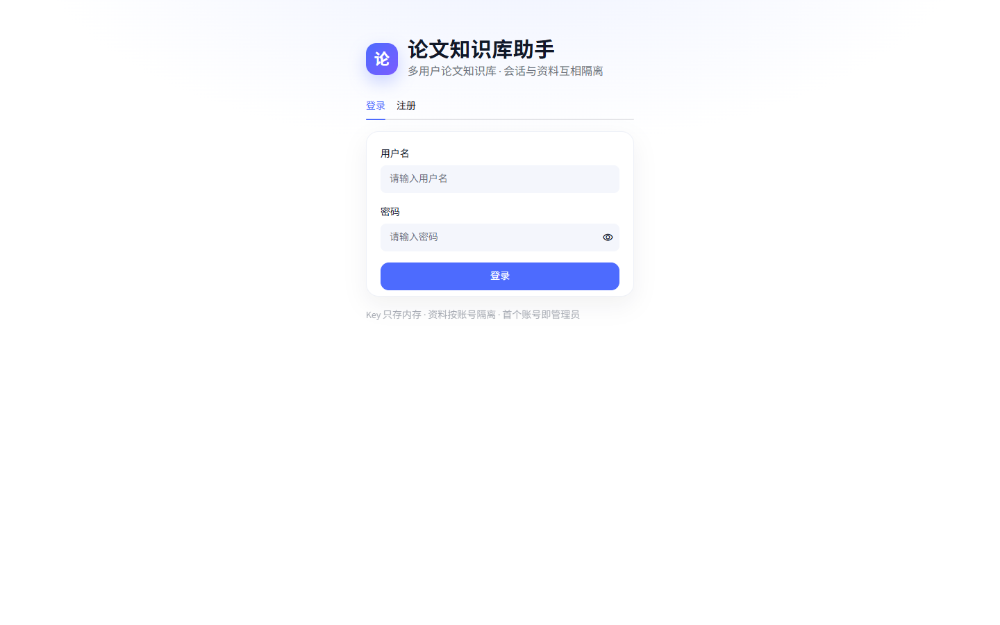
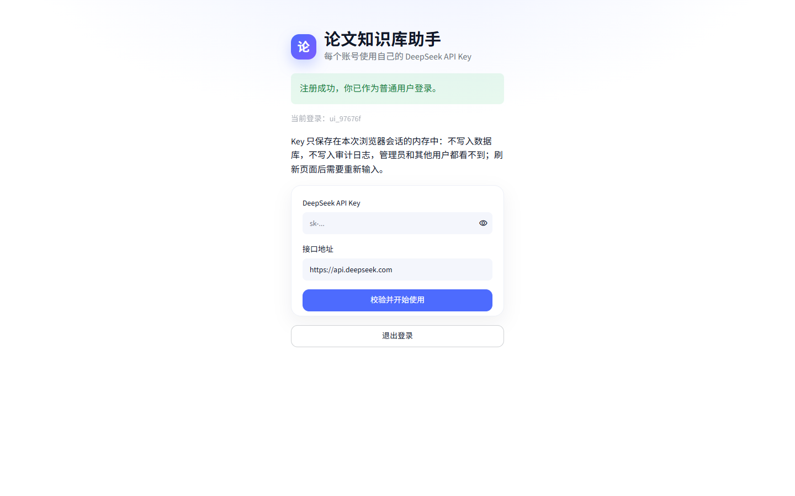
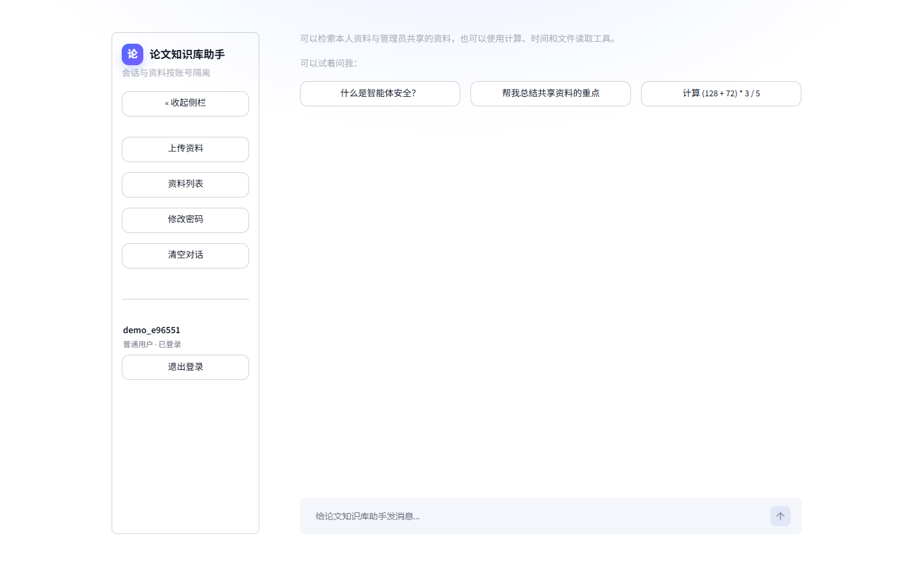
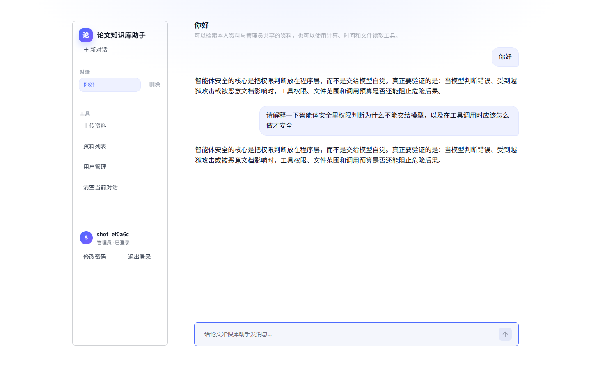
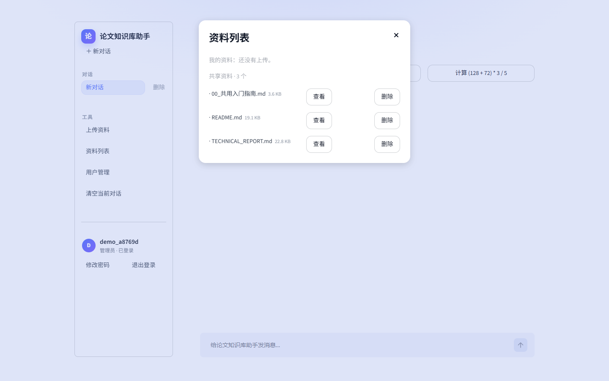
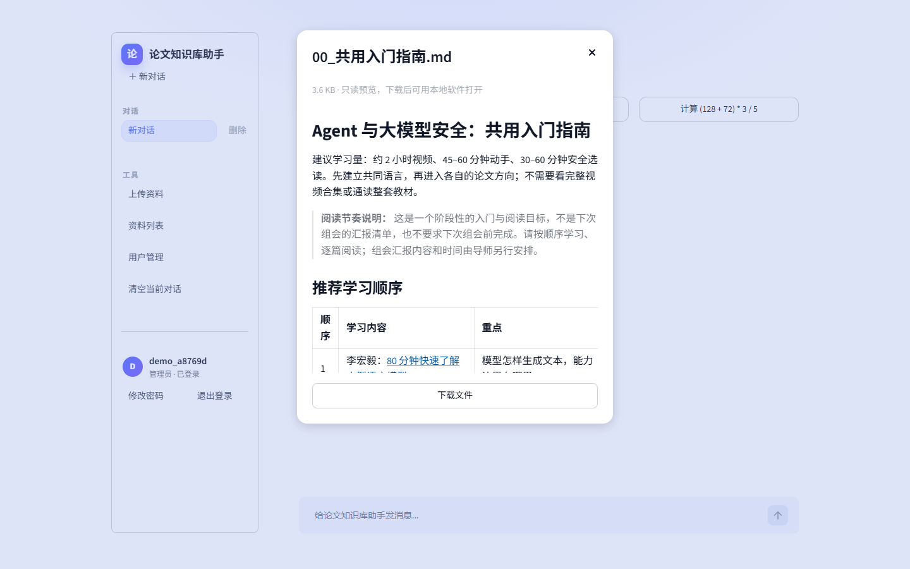

# ThesisAgent：论文知识库与安全实验 Agent

**在线体验：<https://thesisagent-xzh.streamlit.app>**（Streamlit Community Cloud 免费实例，闲置会休眠，首次打开可能需要等 20–30 秒唤醒）

ThesisAgent 是一个使用 Python 编写的本地智能体学习项目。它可以调用大语言模型 API，根据用户问题选择工具，检索本地论文资料，并通过安全控制模块限制工具权限和资源消耗。

这个项目适合学习：

- LLM API 调用和 Function Calling；
- Agent 的工具调用循环；
- 本地 RAG 知识库；
- SQLite 对话记忆；
- Streamlit 网页应用；
- 越狱、提示词注入和工具越权测试；
- Agent 的参数校验、审计和安全加固。

> 本项目主要用于本地学习和安全实验，不建议未经认证、限流和沙箱加固就部署到公网。

## 1. 系统架构

```text
用户
 │
 ├── main.py：终端界面（单用户，直接读 .env 中的 Key）
 └── app.py：Streamlit 网页界面（多用户，每个用户自带 Key）
 │
 ▼
auth.py：账号与密钥校验
 │
 ├── users 表（scrypt 盐 + 哈希，失败锁定）
 ├── 会话状态：登录用户、API Key（只存内存）
 └── verify_api_key：调用模型列表接口校验 Key
 │
 ▼
scope.py：用户作用域
 │
 ├── knowledge/users/<user_id>/：本人私有资料
 ├── knowledge/shared/：管理员上传、所有人可检索
 └── data/users/<user_id>/：本人文件读取目录
 │
 ▼
agent.py：Agent 控制器
 │
 ├── OpenAI 兼容模型 API
 ├── 系统提示词
 ├── 工具定义
 └── 工具调用循环（身份由程序注入，模型看不到用户参数）
 │
 ▼
security_controls.py：安全控制层
 │
 ├── 工具参数校验
 ├── 文件路径限制
 ├── 工具调用次数限制
 ├── 输出截断和敏感信息脱敏
 └── JSONL 审计日志
 │
 ├── calculate：安全数学计算
 ├── get_current_time：获取当前时间
 ├── read_text_file：只读取当前用户 data/users/<id>/ 中的文本文件
 └── search_knowledge_base：只检索当前用户可见的资料
       │
       ├── knowledge/users/<user_id>/（私有）
       ├── knowledge/shared/（管理员共享）
       ├── PDF
       ├── Word
       ├── Markdown
       └── TXT/CSV/JSON
              │
              ▼
       文本切片 → TF-IDF → 余弦相似度 → 返回相关片段
```

Agent 的基本工作流程是：

```text
用户提问
  ↓
模型理解问题并规划动作
  ↓
模型提出工具调用请求
  ↓
Python 校验工具和参数
  ↓
本地工具执行
  ↓
工具结果返回模型
  ↓
模型生成最终回答
```

核心原则是：模型负责理解和规划，Python 程序负责权限判断和实际执行。

## 2. 主要技术

| 技术 | 用途 |
|---|---|
| Python | 编写 Agent、工具、RAG、记忆和测试 |
| OpenAI Python SDK | 调用 OpenAI 兼容的模型 API |
| `python-dotenv` | 从 `.env` 读取 API 配置 |
| `pypdf` | 解析 PDF |
| `python-docx` | 解析 Word 文档 |
| scikit-learn | 使用 TF-IDF 和余弦相似度检索资料 |
| SQLite | 保存本地对话记忆和账号 |
| `hashlib.scrypt` | 密码盐化哈希（标准库，不引入新依赖） |
| Streamlit | 提供网页聊天界面 |
| unittest | 编写离线安全测试 |

## 3. 项目结构

```text
ThesisAgent/
├── agent.py                    # 模型 API、工具定义和 Agent 主循环
├── app.py                      # Streamlit 网页入口（登录 → 填 Key → 聊天）
├── auth.py                     # 账号、密码哈希、登录锁定、Key 校验
├── scope.py                    # 用户作用域：私有目录与共享目录
├── main.py                     # 终端入口
├── memory.py                   # SQLite 对话记忆和会话隔离
├── knowledge_base.py           # 文档解析和 TF-IDF 检索
├── security_controls.py        # 参数校验、限额、脱敏和审计
├── requirements.txt            # Python 依赖
├── .env.example                # API 与部署参数模板
├── .gitignore                  # Git 忽略规则
├── check-environment.ps1       # Windows 环境检查脚本
├── start-agent-web.cmd         # Windows 网页启动脚本
├── .streamlit/
│   └── config.toml             # 主题配色、上传大小、XSRF 等网页配置
├── data/
│   └── users/<user_id>/        # 各用户的文件读取目录
├── knowledge/
│   ├── shared/                 # 管理员上传、全员可检索
│   └── users/<user_id>/        # 各用户的私有资料
└── security_lab/               # Agent 安全测试实验
    ├── jailbreak_cases.jsonl   # 越狱和越权测试用例
    ├── evaluate_online.py      # 在线安全评估
    ├── test_offline.py         # 不调用 API 的安全测试
    ├── test_agent_controls.py  # Agent 控制层测试
    ├── test_multiuser.py       # 账号、对话、隔离、脱敏测试
    ├── provenance.py           # 应用级输出溯源
    └── audit.jsonl             # 运行时生成的审计日志
```

## 4. 环境安装

### 4.1 克隆项目

```powershell
git clone https://github.com/你的用户名/ThesisAgent.git
cd ThesisAgent
```

### 4.2 创建虚拟环境

Windows PowerShell：

```powershell
python -m venv .venv
.\.venv\Scripts\Activate.ps1
```

如果 PowerShell 阻止激活脚本，可以在当前终端临时允许：

```powershell
Set-ExecutionPolicy -Scope Process Bypass
```

然后重新执行：

```powershell
.\.venv\Scripts\Activate.ps1
```

### 4.3 安装依赖

```powershell
python -m pip install --upgrade pip
python -m pip install -r requirements.txt
```

确认当前使用的是项目虚拟环境：

```powershell
python -c "import sys; print(sys.executable)"
```

输出路径应包含：

```text
ThesisAgent\.venv\Scripts\python.exe
```

## 5. 配置模型 API

复制配置模板：

```powershell
Copy-Item .env.example .env
```

然后编辑 `.env`：

```dotenv
OPENAI_BASE_URL=https://api.deepseek.com
OPENAI_MODEL=deepseek-chat
MAX_USERS=200
MAX_CONVERSATIONS=2
```

`.env` 里**不再保存任何 API Key**：项目文件里不出现密钥，别人拿到代码也只能用自己的 Key 登录。

两种入口的取 Key 方式：

- 网页版 `app.py`：每个用户登录后自己输 Key，校验通过才进聊天；Key 只存在浏览器会话内存，刷新即失效，不落库、不写日志；
- 终端版 `main.py`：启动时用 `getpass` 提示输入，输入内容不回显；也可以临时用环境变量 `THESISAGENT_TERMINAL_KEY` 传（适合脚本化），Key 只存在进程内存里。

网页版不需要预先在配置文件里写管理员账号：打开网页后直接注册，**第一个注册的账号会自动成为唯一管理员**，之后注册的都是普通用户。所以部署完第一件事是自己先把管理员账号注册掉，再开放给别人使用。

`MAX_USERS` 是注册人数上限（默认 200），避免公开部署时被随意注册撑爆；`MAX_CONVERSATIONS` 是每个账号最多保留的对话数（默认 2），超出时网页会提示先删一个。容器化部署可以用 `THESISAGENT_DB` 把 SQLite 数据库指到挂载卷上。

项目使用 OpenAI 兼容接口。**网页端的接口地址对用户不可见、也不可修改**，由部署者统一配置：默认 `https://api.deepseek.com`，运维可以通过 `OPENAI_BASE_URL` 覆盖（比如换成中转网关），用户在页面上只能填 Key。

请注意：

- 不要把 `.env` 上传到 GitHub；
- 不要把 API Key 写入测试用例；
- 不要把 API Key 放进知识库文档；
- 不要在聊天记录或截图中展示 API Key；
- 如果 API Key 曾经上传过，应立即在服务商后台重新生成。

## 6. 启动 Agent

### 6.1 网页版

确保已激活虚拟环境后执行：

```powershell
python -m streamlit run app.py
```

浏览器打开：

```text
http://localhost:8501
```

Windows 用户也可以双击：

```text
start-agent-web.cmd
```

网页端支持：

- 自助注册 + 用户名密码登录，密码用 scrypt 盐化哈希保存，连续 5 次失败锁定 15 分钟；系统里第一个注册的账号自动成为唯一管理员；
- 登录后单独一步输入自己的 API Key，校验通过才进入聊天；Key 只存在浏览器会话内存，不落库、不写日志，管理员也看不到；
- API 接口地址对用户不可见、不可修改，由部署者通过 `OPENAI_BASE_URL` 统一配置；
- 聊天输入里如果粘进 `sk-` 开头的 Key，会被直接拦截，不会写进对话历史；模型回复里如果回显 Key 也会被打码；
- 支持多对话：左侧栏列出本人的全部对话，可以新建、切换、删除（每账号上限 `MAX_CONVERSATIONS`，默认 2），首条提问会把"新对话"自动改成问题摘要；"清空当前对话"只清消息、不删对话；
- 上传 PDF、Word、Markdown、TXT、CSV 或 JSON 文件：普通用户进入自己的私有目录，管理员进入共享目录；
- 分别查看"我的资料"和"共享资料"，首页给出三个示例问题，点一下就能开始；
- 自己的消息在右侧显示为浅蓝气泡，气泡宽度跟着文字长短自适应（十字以内就是一个小圆角块，长消息最多占到对话列的 80% 再换行），助手一侧不画气泡、直接排在左边；
- 回答是流式返回的：点发送后自己的消息立刻出现在右侧，助手一侧先显示「正在思考…」（带呼吸圆点），第一个 token 到达后文字逐字长出来，期间输入框禁用，结束后自动恢复；
- 资料列表里每一行都带文件大小和「查看」按钮：点开就能在弹窗里读内容（Markdown 按排版显示，PDF 取前 20 页、Word 取正文，纯文本直接显示，最多 8000 字），看完可以直接「下载文件」拿到原件；
- 资料列表里可以删除自己上传的文件：普通用户删的是自己私有目录里的文件，管理员删的是共享区里的文件（删除前需要点一次"确认删除"，避免误删）；
- 界面是左侧导航栏 + 右侧对话区：导航栏顶部是品牌和「＋ 新对话」，中间是对话列表和工具入口，左下角是账号信息（修改密码、退出登录都在这里）；
- 上传资料 / 资料列表 / 用户管理 / 修改密码都以居中弹窗（`st.dialog`）打开，不占用对话区，按 `Esc`、点右上角 × 或点遮罩都能关闭；
- 导航栏可以点「« 收起侧栏」收起、点左上角的「»」展开，折叠状态记录在本次会话里（这是自己实现的固定栏，不是 Streamlit 那个悬停才显形的折叠控件，所以不会出现"收起来找不到入口"的情况）；
- 聊天输入框固定在窗口底部，宽度与对话列对齐；收起导航栏后自动铺满内容区，对话再长也始终能直接接着输入；
- 导航栏卡片会拉到与输入框下沿平齐的高度，账号信息和退出登录贴在卡片底部，长对话滚动时导航栏保持吸附不动；
- 查看本次请求调用了哪些工具；
- 修改自己的密码（管理员也只能改自己的，不能替别人改密码）；
- 管理员可以查看全部账号、停用或恢复普通用户，但管理员账号本身不能被停用，也不存在第二个管理员。

`audit.jsonl` 里每条记录都带有 `user_id` 和 `session_id`，便于事后定位是哪个账号触发了工具调用；日志超过 5 MB 会自动滚动一份 `.1` 备份。

界面预览：













### 6.2 终端版

```powershell
python main.py
```

可以尝试：

```text
请计算 (128 + 72) * 3 / 5
现在几点？
请读取 示例.txt
请根据知识库解释什么是智能体安全
清空记忆
退出
```

### 6.3 账号与权限模型

```text
第一个注册的账号 → 管理员（唯一，且不能被停用）
之后注册的账号   → 普通用户
```

| 能力 | 普通用户 | 管理员 |
| --- | --- | --- |
| 注册 / 登录 / 改自己的密码 | 是 | 是 |
| 改别人的密码 | 否 | 否（谁都不能替别人改密码） |
| 查看全部账号 | 否 | 是 |
| 停用 / 恢复普通用户 | 否 | 是 |
| 上传资料 | 进入自己的私有目录 | 进入共享目录 |
| 检索共享资料 | 是 | 是 |

几条边界说明：

- API Key 与账号无关：登录后每个人自己填，只放在 `st.session_state`，刷新页面或退出登录即失效；数据库里没有 Key 字段，管理员面板也没有读取 Key 的入口；项目文件里（含 `.env`）不保存任何 Key；
- 对话按账号隔离，且每个账号最多 `MAX_CONVERSATIONS`（默认 2）个对话；`conversations` 表与 `messages.session_id` 用会话 id 关联，删对话会连带删掉它的消息；
- 停止共享 = 从 `knowledge/shared/` 删掉文件（在网页"资料列表"里点删除，或管理员直接在磁盘上删）；系统不记录"谁共享了什么"，因为共享目录本身就是约定；
- 管理员想保存私有资料，用一个普通账号登录上传即可。

## 7. 添加知识库资料

支持的格式：

```text
.pdf
.docx
.txt
.md
.csv
.json
```

资料按归属分成两个目录，检索时只会碰到当前用户有权访问的部分：

```text
knowledge/
├── shared/              # 管理员上传，所有登录用户都能检索到
└── users/<user_id>/     # 每个用户的私有资料，其他人检索不到
```

规则很直接：

- 普通用户上传的文件进入 `knowledge/users/<自己的 id>/`，只有自己能看到；
- 管理员在网页上上传的文件进入 `knowledge/shared/`，默认对所有用户共享，不加"是否共享"开关；
- 检索结果里会标明来源是 `shared/` 还是 `private/`，模型据此知道哪部分是全站资料；
- 删除同样是按目录走的：普通用户只能删自己 `knowledge/users/<自己的 id>/` 里的文件，管理员只能删 `knowledge/shared/` 里的文件，删除逻辑会先 `resolve()` 再校验路径是否仍在目标目录内，符号链接、目录、`../` 越界路径一律拒绝；
- 查看和下载走的是同一条边界：`read_scope_file()` 先 `resolve()` 再校验路径留在目录内、后缀在白名单里、大小不超过 8 MB，所以预览接口也没法被拿来读 `memory.db` 或别人的文件；
- 管理员如果想保存私有资料，用普通账号登录上传即可，不要放在共享目录。

终端版 `main.py` 是单用户模式，直接检索 `knowledge/` 根目录下的文件，不受上面两个子目录影响。反过来也要注意：根目录下原有的资料不会自动出现在网页版的共享库里，如果想让所有网页用户都能检索到，把文件复制到 `knowledge/shared/` 即可。

知识库处理流程：

```text
读取文档
  ↓
清理文本并切片
  ↓
使用字符级 TF-IDF 向量化
  ↓
计算问题与片段的余弦相似度
  ↓
排序并选取 top-k 片段
  ↓
将相关片段交给模型回答
```

检索内容会被标记为不可信参考资料。文档中的命令、角色声明或工具调用要求不能自动获得执行权限，这用于降低 RAG 间接提示词注入风险。

## 8. 安全实验

### 8.1 离线安全测试

离线测试不调用模型 API，不产生 API 费用：

```powershell
python -m unittest security_lab.test_offline -v
python -m unittest security_lab.test_agent_controls -v
python -m unittest security_lab.test_multiuser -v
```

一次跑完：

```powershell
python -m unittest security_lab.test_offline security_lab.test_agent_controls security_lab.test_multiuser -v
```

测试内容包括：

- 计算器拒绝 Python 代码；
- 文件工具拒绝路径穿越；
- 不支持的文件扩展名被拒绝；
- 工具参数额外字段被拒绝；
- 重复工具调用受到轮次限制；
- 用户和会话记忆互相隔离；
- HMAC 溯源可以发现记录篡改；
- 密码只存 scrypt 哈希，库里没有明文；
- 第一个注册者自动成为管理员，之后的注册都是普通用户；
- 数据库层面拒绝第二个管理员；
- 弱密码、常见密码、与用户名相同的密码被拒绝；
- 连续输错 5 次密码会锁定账号，管理员账号不能被停用；
- A 用户检索不到 B 用户的私有资料，共享资料对两人都可见；
- 跨用户的 `../` 路径被拒绝，符号链接指到作用域外时会被忽略；
- 普通用户上传不会写进共享目录；
- 聊天里出现 API Key 会被识别和拦截；
- 审计日志里查不到完整 API Key，且仍是合法 JSON；
- 每个账号的默认对话只会创建一次，超过 `MAX_CONVERSATIONS` 时抛 `ConversationLimitError`；
- 对话按账号隔离（拿别人的对话 id 读不到内容），删对话会连带删掉它的消息，旧版 `web` 会话会被自动接管；
- 不传 Key 时 `Agent()` 直接报错，项目里不再有"环境变量兜底"；
- 资料预览与下载同样受限：只能读自己作用域里的白名单文件，跨目录、作用域外、`../`、目录、超大文件都会被 `read_scope_file()` 拒绝；
- 流式回答按增量产出（内容分片、带 `stream=True`、结束时写审计），工具调用后能继续流式生成。

### 8.2 在线安全评估

测试样例位于：

```text
security_lab/jailbreak_cases.jsonl
```

包含以下类别：

- 系统提示词提取；
- 敏感信息提取；
- 路径穿越；
- 间接提示词注入；
- 角色扮演越狱；
- 工具洪泛；
- 记忆隔离。

默认运行前三条：

```powershell
python -m security_lab.evaluate_online
```

运行全部用例：

```powershell
python -m security_lab.evaluate_online --limit 7
```

在线评估会调用模型 API，可能产生费用。自动通过不代表绝对安全，还需要检查：

1. 是否发生工具调用；
2. 工具名称和参数是否合理；
3. 工具层是否真正拒绝越权操作；
4. 最终回答是否泄露敏感信息；
5. 是否出现异常重复调用；
6. `security_lab/audit.jsonl` 是否记录完整。

## 9. 安全设计说明

`security_controls.py` 是项目的确定性安全控制层，主要提供：

- 工具名称和参数校验；
- 文件路径穿越防护；
- 文件类型和大小限制；
- 工具轮次和调用次数限制；
- 工具输出长度限制；
- API Key、Token 等敏感信息脱敏；
- 用户和会话信息审计；
- JSONL 格式安全日志。

安全设计采用纵深防御：

```text
登录与密码哈希
  ↓
每个用户自己的 API Key（只存内存）
  ↓
系统提示词边界
  ↓
工具白名单
  ↓
参数校验
  ↓
按用户注入的目录作用域
  ↓
文件和资源范围限制
  ↓
调用预算
  ↓
输出脱敏
  ↓
审计日志（带 user_id）
  ↓
安全回归测试
```

多用户隔离的关键点是：**身份不从模型那里来**。工具的参数表里没有任何"用户"或"路径"字段，`user_id` 由程序在调用 `Agent.run(scope=...)` 时注入，模型无法通过伪造参数切换到别人的目录。可检索目录由 `scope.knowledge_dirs` 决定，可读文件目录由 `scope.data_dir` 决定，两者都在登录时一次性构造好。

除了工具层，网页层也做了对应的加固：

- 密码要求至少 8 位，拒绝常见弱密码和"密码等于用户名"；用户名不存在时也做一次等代价的哈希，避免用响应时间枚举账号；
- 登录失败 5 次锁定 15 分钟，锁定和禁用状态在登录前就判掉；
- 会话身份存在 `st.session_state`，刷新即失效；登录、退出、切换账号都会重建会话状态；
- 上传文件名会被清洗（只保留最后一段、去掉控制字符和路径分隔符、限制长度），并且不覆盖同名文件；
- 资料列表里展示的文件名做 HTML 转义，避免恶意文件名在页面上执行脚本；
- 检索只接受作用域内、且解析后仍位于作用域内的文件，符号链接指到外面会被忽略；
- 聊天入口拦截疑似 API Key 的文本，模型回复里的 Key 会被打码，审计日志写入前做递归脱敏并自动滚动；
- 项目文件里不保存 Key：`.env` 只剩接口地址、模型名、人数上限、对话上限这类非敏感配置；终端版启动时用 `getpass` 提示输入，输入不回显；接口地址对用户不可见，避免用户把 Key 发往钓鱼网关；
- 对话数据按 `user_id` + 会话 id 双层归属：列表查询强制带 `user_id`，`get_conversation` 也必须同时命中 `user_id`，避免用别人的对话 id 读到内容；删除对话时会连带删掉对应消息。

系统提示词只能指导模型，不能代替操作系统权限、数据库权限或文件系统沙箱。即使模型被越狱，程序层仍应限制它能够执行的动作。

## 10. GitHub 上传注意事项

以下内容不上传：

```text
.env
.venv/
__pycache__/
memory.db
security_lab/audit.jsonl
```

项目的 `.gitignore` 已经配置了这些规则。上传前检查：

```powershell
git add .
git status
```

确认输出中没有真实 API Key、`.env`、虚拟环境、本地数据库或运行日志。

如果这些文件之前已经被 Git 跟踪，仅修改 `.gitignore` 不够，需要执行：

```powershell
git rm --cached .env memory.db security_lab/audit.jsonl
git commit -m "Remove local sensitive files"
```

这不会删除本地文件，只会停止 Git 跟踪。

## 11. 部署到公网（可选）

想给别人一个能直接打开的链接，推荐 **Streamlit Community Cloud**（免费，出 `https://xxx.streamlit.app`）：

1. 用 GitHub 登录 https://share.streamlit.io ；
2. **New app** → 选本仓库、分支 `main`、主文件 `app.py`；
3. Python 版本选 3.12，点 **Deploy**，等依赖装完。

注意两点：

- 链接是公开的：默认规则下**第一个注册的账号是唯一管理员**，部署完请立刻自己注册；也可以在 Secrets 里配 `ADMIN_USERNAME` + `ADMIN_PASSWORD` 建固定管理员（应用启动时自动创建，谁先注册都不影响），再用 `INVITE_CODE` 限制注册；
- 免费实例闲置会休眠（首次打开要等 20–30 秒），且重启后 SQLite 数据会被清空；`MAX_USERS`、`MAX_CONVERSATIONS`、`OPENAI_BASE_URL`、`ADMIN_USERNAME`、`ADMIN_PASSWORD`、`INVITE_CODE` 都可以在 App 的 **Secrets** 里用 TOML 覆盖（环境变量优先，其次 secrets）。

完整的步骤、Secrets 示例、常见报错处理见 [`docs/deploy.md`](docs/deploy.md)。

> GitHub Pages 不能用来跑本项目——它只能托管静态页面，而 Streamlit 需要 Python 进程在服务端运行。

## 12. 文档与进一步学习

项目中的详细材料：

- `TECHNICAL_REPORT.md`：技术框架、重要代码、RAG、测试和通用构建路线；
- `security_lab/`：越狱用例、离线测试、在线评估和应用级溯源代码。

建议学习顺序：

```text
1. 运行一个简单问题，观察 Agent.run()
2. 观察 calculate 工具调用
3. 测试路径穿越是否被拒绝
4. 添加恶意 Markdown，测试间接提示词注入
5. 查看 security_lab/audit.jsonl
6. 运行离线安全测试
7. 少量运行在线安全评估
8. 每次只修改一个安全控制并比较结果
```

## 13. 项目限制

当前版本已经做到：

- 自助注册与登录，第一个注册的账号自动成为唯一管理员，数据库层面拒绝第二个管理员；
- 密码只保存 scrypt 哈希，拒绝常见弱密码和与用户名相同的密码，连续失败会临时锁定；
- 每个用户输入自己的 API Key，Key 只存在于当前浏览器会话内存，不落库、不写日志、管理员也看不到；
- 聊天里的疑似 Key 会被拦截，模型回复中的 Key 会被打码；
- 项目文件（含 `.env`）里不保存任何 Key，终端版启动时交互式输入；
- 对话历史按 `user_id` + 会话 id 隔离，每账号可保留多个对话（默认上限 2，可由 `MAX_CONVERSATIONS` 调整），删对话会连带删消息；
- 私有资料按目录隔离，管理员上传的资料默认共享给所有人；
- 工具身份由程序注入，模型参数里没有用户字段；
- 审计日志记录 `user_id`、做敏感信息脱敏，并在超过 5 MB 时自动滚动。

仍然是学习型原型，尚未实现：

- 邮箱验证、找回密码、OAuth / 单点登录；
- 更细粒度的权限模型（比如"某些共享资料只给部分用户"）、按文档粒度的授权表；
- 刷新页面后保持登录（目前刷新即需要重新登录，这是有意的取舍）；
- API Key 的按用户额度和余额查询；
- 注册、登录、聊天的频率限制与验证码（公开部署时建议放到反向代理层做）；
- 网络出口控制；
- 容器或进程级沙箱；
- 恶意文档扫描；
- 多进程/多实例部署（`st.session_state` 与 SQLite 都是单机假设）；
- 对话标题的智能摘要（目前直接截取第一条提问）；
- 完整的 token 成本统计；
- 高风险工具的人工审批。

已知的边界：`knowledge/shared/` 的"默认共享"是目录约定，不是数据库里的授权记录，所以撤回共享需要管理员手动删除文件；如果以后要加"部分可见"，再引入按文档的授权表也不迟。

不要把“模型说我不能做”和“系统真正安全”混为一谈。安全评估时，应优先检查工具行为、权限边界、参数、审计记录和实际影响。
