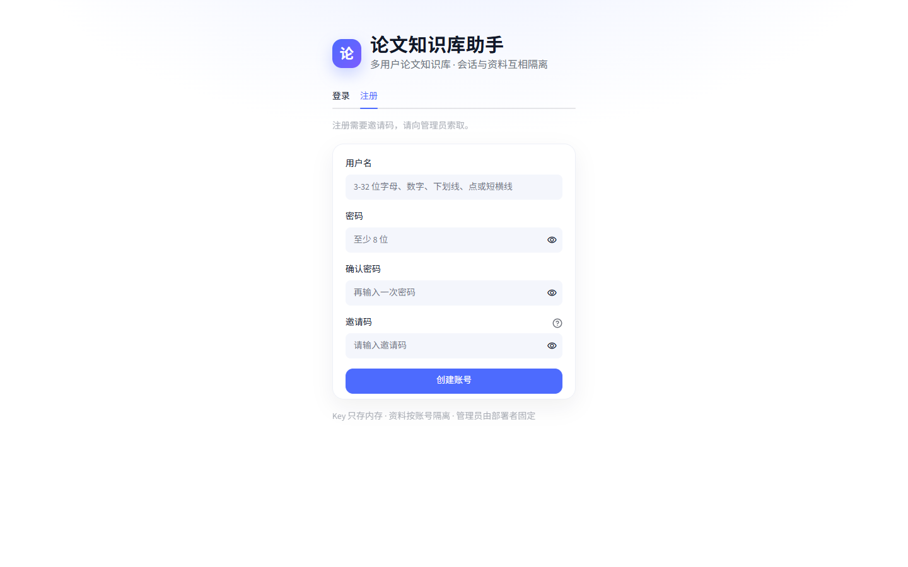

# 部署到 Streamlit Community Cloud

目标：把本地的 ThesisAgent 变成 `https://<你的名字>.streamlit.app` 这样的公网链接，
别人打开浏览器就能注册、登录、用自己的 API Key 使用，不需要你的电脑开机。

> 说明：GitHub Pages 只能托管静态页面，跑不了 Streamlit（它需要 Python 进程），
> 所以这里用 Streamlit 官方的免费托管。

## 0. 前提

- GitHub 仓库是 **Public**（免费版只支持公开仓库）；
- 仓库根目录有 `app.py`、`requirements.txt`、`.streamlit/config.toml`（本项目已具备）；
- 你的 API Key **不会**上传：本项目任何文件里都不保存 Key，用户登录后自己填。

## 1. 创建应用

1. 打开 https://share.streamlit.io ，用 GitHub 账号登录；
2. 点 **Create app** 或 **New app**；
3. 按下表填写：

   | 字段 | 值 |
   | --- | --- |
   | Repository | `<你的账号>/ThesisAgent` |
   | Branch | `main` |
   | Main file path | `app.py` |
   | App URL | 想要的自定义前缀（可改） |

4. 展开 **Advanced settings**：
   - Python version 选 `3.12`；
   - **Secrets** 可以先留空，也可以按下面的「可选配置」填。
5. 点 **Deploy**，第一次会装依赖（2–5 分钟），装完自动打开应用。

## 2. 立刻做的第一件事

应用是公开的，默认规则下**第一个注册的账号会自动成为唯一管理员**。所以部署完请马上：

1. 打开你的 `https://xxx.streamlit.app`；
2. 切到「注册」标签，注册你自己的账号（用户名 3–32 位，密码至少 8 位）；
3. 确认页面显示「管理员 · 已登录」，然后再把链接发给别人。

管理员能查看全部账号、停用普通用户，但**看不到任何人的 API Key**（Key 只在各自浏览器内存里）。

> 想彻底不依赖"谁先注册"？在 Secrets 里配 `ADMIN_USERNAME` + `ADMIN_PASSWORD`（见下一节），
> 应用启动时会自动创建这个固定管理员，之后别人注册一律是普通用户，重置实例也不会丢管理员身份。

## 3. 可选配置（Secrets）

应用支持从 Streamlit Secrets 读配置，路径：**App → Settings → Secrets**，粘贴：

```toml
# 注册人数上限
MAX_USERS = "50"

# 每个用户最多保留几个对话
MAX_CONVERSATIONS = "2"

# 接口地址（网页上不可见，用户改不了；要换中转网关时改这里）
OPENAI_BASE_URL = "https://api.deepseek.com"
OPENAI_MODEL = "deepseek-chat"

# 固定管理员：应用启动时自动创建 / 提升这个账号，其他注册者都是普通用户
ADMIN_USERNAME = "admin"
ADMIN_PASSWORD = "换成你自己的强密码"

# 注册邀请码：配置后注册必须填对，不想让别人随便注册时用
INVITE_CODE = "给我同学的口令"
```

保存后应用会自动重启。不填就用代码里的默认值（`MAX_USERS=200`、`deepseek-chat`、第一个注册者是管理员、注册不需要邀请码）。



配置了 `ADMIN_USERNAME` 时：

- 第一次启动自动建号（密码取 `ADMIN_PASSWORD`），用这组账号密码直接登录即可；
- 之后你在网页上"修改密码"改的是数据库里的密码，**不会**被 Secrets 覆盖（Secrets 只在账号不存在时用一次）；
- 用户名被普通用户占用且已经存在别的管理员时，页面顶部会出现黄色提示，换个 `ADMIN_USERNAME` 即可。

## 4. 数据会丢吗

会。免费版的容器是临时的，**重启/重新部署后数据会被清空**：

- `users`（账号）、`conversations` / `messages`（对话）、`knowledge/users/<id>`（私有资料）都会没；
- `knowledge/shared/` 里随仓库提交的文件会跟着代码回来。

需要真正持久化时：

1. 在 App 的 Secrets 里设置数据库路径，指到可写且持久的目录；
2. 更稳妥的做法是换到带持久盘的平台（Render/Railway 的 Volume、或自己的 VPS + Docker）。

本项目在云端会优先用项目目录、不可写时自动退到系统临时目录，所以**运行期间不会因为写库报错**，
只是重启后内容不保留。

## 5. 以后更新

- `git push` 到 `main` 分支后，Streamlit Cloud 会自动重新部署；
- 想在页面上手动触发：App 右上角 **⋮ → Reboot app**；
- 改了依赖（`requirements.txt`）一定要 Reboot，否则还是旧环境。

## 6. 常见问题

| 现象 | 处理 |
| --- | --- |
| 打开是空白 / `Please wait` 很久 | 免费实例闲置后会休眠，第一次唤醒要 20–30 秒 |
| `ModuleNotFoundError` | `requirements.txt` 漏了包，补上再 push，然后 Reboot |
| 一直转圈、日志里 `Error installing requirements` | 多半是版本钉太死或缺少编译环境，先把版本改成不带 `==` 的包名试一次 |
| 登录后填 Key 校验失败 | 检查用户的 Key 是否有效、额度是否用完；接口地址在云端要能访问 `api.deepseek.com` |
| 上传大文件失败 | 云端默认请求体上限比本地小，`MAX_UPLOAD_BYTES` 已设为 10 MB，别传更大的 |
| 国内访问 `.streamlit.app` 慢 | 可以让访客挂代理，或改走自己的服务器（Cloudflare Tunnel / VPS） |

## 7. 上不了公网时的备选

- **Hugging Face Spaces**：同样免费，支持 Streamlit SDK 与 Docker；
- **本机 + 隧道**：`cloudflared tunnel --url http://localhost:8501` 或 `ngrok http 8501`，
  一分钟出临时链接，适合当面演示（电脑要开着、链接是随机的）；
- **VPS + Docker**：最稳，能挂持久盘、绑自己的域名，但要自己维护。
